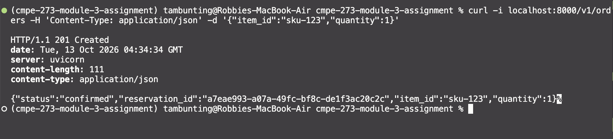
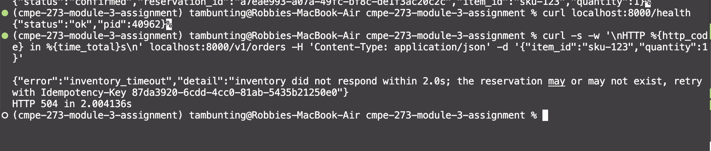
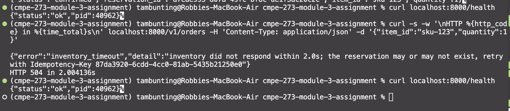
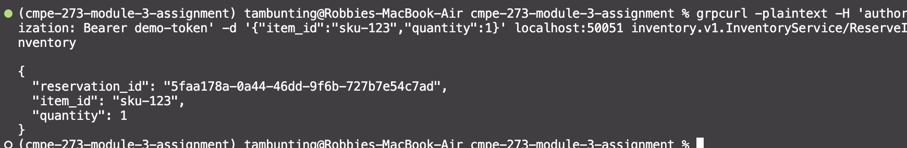
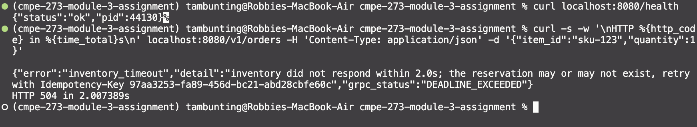
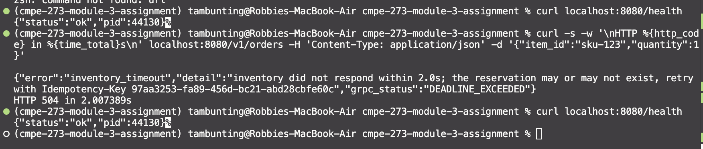

# Order → Inventory over REST and gRPC

The same service interaction built twice:

- **Order Service** accepts an order (`item_id`, `quantity`).
- **Inventory Service** reserves stock if the item exists and enough is available.

The Order → Inventory hop is implemented once with REST/JSON and once with gRPC. Both Order Services expose the same HTTP front door (`POST /v1/orders`, `GET /health`), so the only difference between the two versions is how Order talks to Inventory. Each version sets a client timeout/deadline, maps failures to proper statuses, and keeps running when Inventory is slow.

## Layout

```
common/config.py               ports, timeout/deadline, demo token
common/inventory_store.py      shared in-memory store + domain errors (used by both versions)
rest_version/                  FastAPI inventory (:8001) and order (:8000) services
grpc_version/                  inventory.proto, generated stubs, gRPC inventory (:50051), order (:8080)
tests/                         pytest suite
scripts/gen_proto.sh           regenerates the gRPC stubs
```

The folders are `rest_version/` and `grpc_version/` (not `grpc/`) so a local folder never shadows the `grpc` library.

## Setup

Requires Python 3.10+. From the repo root:

```bash
python -m venv .venv          # or: uv venv
source .venv/bin/activate
pip install -r requirements.txt   # or: uv pip install -r requirements.txt
```

The generated gRPC stubs (`grpc_version/inventory_pb2*.py`) are committed, so no code generation is needed to run. To regenerate them after editing `inventory.proto`:

```bash
./scripts/gen_proto.sh
```

Run everything from the repo root as modules (e.g. `python -m rest_version.order_service`).

## Configuration

Plain constants in [common/config.py](common/config.py), no env vars:

| Setting | Value |
|---|---|
| REST ports (order / inventory) | 8000 / 8001 |
| gRPC ports (order / inventory) | 8080 / 50051 |
| REST client timeout | 2.0 s |
| gRPC client deadline | 2.0 s |
| Demo bearer token | `demo-token` |

The only run-time setting is the slow-inventory delay: both inventory servers take `--delay SECONDS` (default 0), which sleeps before handling each request.

Seed stock: `sku-123` = 5, `sku-456` = 1 (use quantity 2 to get a 409), `sku-789` = 0.

## Run the REST version

Use three terminals, each with the venv activated.

```bash
# 1. Inventory Service (REST) on :8001
python -m rest_version.inventory_service

# 2. Order Service (REST) on :8000
python -m rest_version.order_service

# 3. Place an order
curl -i localhost:8000/v1/orders -H 'Content-Type: application/json' \
  -d '{"item_id":"sku-123","quantity":1}'
```

To simulate a slow inventory, restart terminal 1 with a delay longer than the 2 s timeout:

```bash
python -m rest_version.inventory_service --delay 5
```

## Run the gRPC version

```bash
# 1. Inventory Service (gRPC) on :50051, with server reflection enabled
python -m grpc_version.inventory_server

# 2. Order Service (HTTP front door, gRPC to inventory) on :8080
python -m grpc_version.order_service

# 3. Place an order
curl -i localhost:8080/v1/orders -H 'Content-Type: application/json' \
  -d '{"item_id":"sku-123","quantity":1}'
```

To simulate a slow inventory, restart terminal 1 with a delay longer than the 2 s deadline:

```bash
python -m grpc_version.inventory_server --delay 5
```

The Inventory Service can also be called directly with `grpcurl` (reflection is on):

```bash
grpcurl -plaintext -H 'authorization: Bearer demo-token' \
  -d '{"item_id":"sku-123","quantity":1}' \
  localhost:50051 inventory.v1.InventoryService/ReserveInventory
```

## Evidence: REST version

### Successful request and response

`POST /v1/orders` through the Order Service returns `201 Created` with a confirmed reservation.



### Timeout handling

Inventory was restarted with `--delay 5`, longer than the Order Service's 2 s timeout. The Order Service gives up after 2.004 s and returns `504 inventory_timeout` instead of hanging or crashing.



### Order Service remains running

`/health` reports the same `pid` (40962) before and after the failed request, so the Order Service process was not restarted or killed.



## Evidence: gRPC version

### Successful request and response

A direct `grpcurl` call to `inventory.v1.InventoryService/ReserveInventory` on the Inventory Service (port 50051) returns the reservation as a `ReserveResponse` message (shown as JSON by `grpcurl`).



### Deadline handling

Inventory was restarted with `--delay 5`, longer than the Order Service's 2 s deadline. The call fails with `DEADLINE_EXCEEDED`, which the Order Service maps to `504 inventory_timeout` after 2.007 s. The gRPC status name is included in the response body (`grpc_status`).



### Order Service remains running

`/health` reports the same `pid` (44130) before and after the failed request, so the Order Service process was not restarted or killed.



## REST vs gRPC comparison

With REST, I could test everything with curl. The contract was defined by the API route, the JSON body, and the status codes. gRPC, on the other hand, required writing the `.proto` file and generating stubs first. Once the stubs were generated, the Order Service could call inventory through a typed stub like a local function. Error handling differed: REST uses HTTP codes like 404 and 409, while gRPC uses its own statuses like `NOT_FOUND` and `DEADLINE_EXCEEDED`, which the Order Service had to map back to HTTP. In both versions, a slow inventory produced a 504 error from the Order Service, and the Order Service kept running with the same PID.

## Tests

```bash
python -m pytest -q
```

(Use `python -m pytest`, not bare `pytest`, so the repo root is on the import path.)

## Contract

The operation is a reservation: reserve `quantity` units of `item_id`.

**REST** — `POST /v1/reservations` on Inventory, body `{"item_id": str, "quantity": int}`, header `Authorization: Bearer <token>`, optional `Idempotency-Key`. Errors are `{"error": "<code>", "detail": "..."}`.

**gRPC** — `inventory.v1.InventoryService/ReserveInventory` with `ReserveRequest {item_id, quantity, idempotency_key}` → `ReserveResponse {reservation_id, item_id, quantity}`. The token goes in `authorization` metadata. See [inventory.proto](grpc_version/inventory.proto).

### Status mapping

| Outcome | REST (Inventory) | gRPC (Inventory) | Order Service returns |
|---|---|---|---|
| Reserved | 201 | `OK` | 201 `{"status":"confirmed", ...}` |
| Invalid quantity (< 1) | 400 | `INVALID_ARGUMENT` | 400 |
| Unknown item | 404 | `NOT_FOUND` | 404 |
| Insufficient stock | 409 | `FAILED_PRECONDITION` | 409 |
| Idempotency key reused with a different body | 422 | `ALREADY_EXISTS` | (not reachable through Order; it generates the key) |
| Missing/invalid token | 401 | `UNAUTHENTICATED` | — |
| Inventory too slow | client timeout | `DEADLINE_EXCEEDED` | 504 `inventory_timeout` |
| Inventory unreachable | connect error | `UNAVAILABLE` | 503 `inventory_unavailable` |
| Anything else from Inventory | other status | other code | 502 `inventory_error` |

The gRPC Order Service also includes the gRPC status name in its response body (`"grpc_status": "DEADLINE_EXCEEDED"`) and in its logs.

### Idempotency

The Order Service sends an idempotency key (the client's `Idempotency-Key` header, or a generated UUID) on every Inventory call. Inventory stores the result per key, so a retry with the same key and body returns the same `reservation_id` and does not decrement stock a second time. This is what makes retrying safe after a timeout, when the client cannot know whether the reservation was made.
